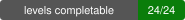
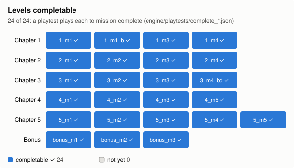
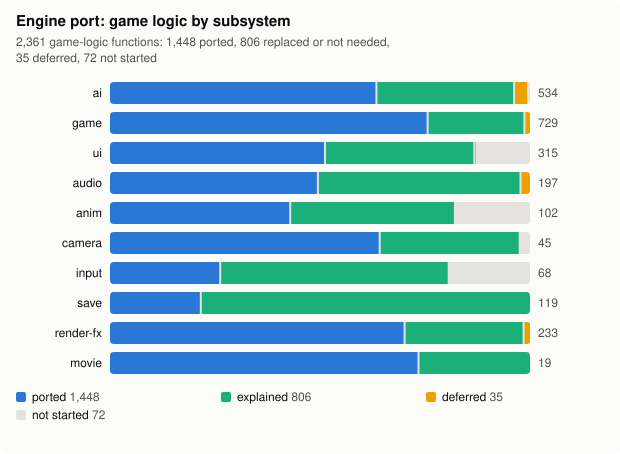
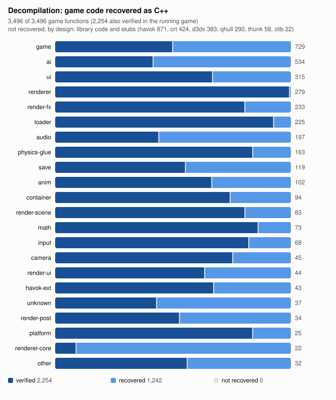
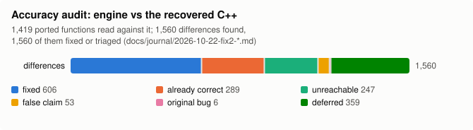

# Armed and Dangerous: Remaster

A clean Rust / Bevy / Jolt remaster of *Armed and Dangerous* (Planet Moon Studios, 2003), written from a full
decompilation of the PC game, with the original game itself as the oracle for how everything should behave.

<!-- PREVIEW IMAGE: add docs/images/preview.png (a 1280x720 screenshot of the Remaster preset, taken from your own
     copy) and replace this comment with:
<p align="center"></p>
-->

<p align="center">
  <a href="#getting-started">Getting started</a> ·
  <a href="docs/play-guide.md">Play guide</a> ·
  <a href="docs/remaster-engine.md">Engine handover</a> ·
  <a href="archive/README.md">The decompilation</a> ·
  <a href="CONTRIBUTING.md">Contributing</a> ·
  <a href="docs/decision.md">Decisions</a>
</p>

You need your own copy of the game: this repository contains no game data. It does not ship a ready-to-run build
yet either; you build it from source (below).

## Status

 
 

<picture>
  <source media="(prefers-color-scheme: dark)" srcset="docs/progress/levels-dark.svg">
  
</picture>

<picture>
  <source media="(prefers-color-scheme: dark)" srcset="docs/progress/port-dark.svg">
  
</picture>

<details>
<summary>Decompilation and accuracy audit</summary>

<picture>
  <source media="(prefers-color-scheme: dark)" srcset="docs/progress/decompilation-dark.svg">
  
</picture>

<picture>
  <source media="(prefers-color-scheme: dark)" srcset="docs/progress/audit-dark.svg">
  
</picture>

</details>

The charts are generated from the repository's own data by `python tools/progress.py` (sources listed in its
header) and refreshed on every push to main.

### What works today

- **All 24 levels** (the 21 campaign levels and the 3 bonus levels) can be played to mission complete: a playtest
  plays each one through its real objective chain and on to the next level (`engine/playtests/complete_*.json`).
  Not every behaviour is tuned against the original yet; docs/play-guide.md lists the known rough edges.
- The game's own content and rules: the campaign flow with its movies, the pub, the weapon roster (including the
  Topsy Turvy bomb, the land shark gun and the vindaloo), companions, base defence levels, vehicles and bosses, the
  HUD and menus, save / load, the original's cheat codes, subtitles and audio. Mechanics come from the recovered
  code, with the original's addresses cited in the source.
- **Two presets:** *Remaster* (the default: ambient occlusion, temporal anti-aliasing, high-resolution soft shadows,
  bloom, soft particles, tessellated characters, height fog, motion blur, GPU snowfall, and the optional AI
  retexture pack) and
  *Original* (the original's look, used for every comparison and test). Any resolution, window or fullscreen,
  keyboard / mouse and gamepad with prompts for the device in use, key rebinding.
- **Developer tools:** a developer menu (F1: level select, god mode, infinite ammo, quick save / load), and session
  recording with **F8 bookmarks** (a screenshot, a save and a note of the moment) that turn straight into a
  reproducible playtest. Recordings stay on your machine. See docs/play-guide.md.

### Compatibility

- **Windows 10 / 11, 64-bit.** The only platform built and played so far; Linux and macOS are untested (Bevy and
  Jolt support them, the asset tools are plain Python, but nobody has tried).
- **Game version:** the Steam release (app 6090, build 251748) is the tested one. Other releases (for example GOG)
  are untested; `tools/setup_assets.py` reports an unknown build and tries anyway. Reports welcome.
- A GPU with current DirectX 12 or Vulkan drivers.

## Getting started

### 1. Prerequisites

- [Git](https://git-scm.com/)
- [Rust](https://rustup.rs/) stable (tested with 1.99) and the MSVC build tools (Visual Studio Build Tools, "Desktop
  development with C++"); [CMake](https://cmake.org/) on PATH (Jolt Physics is built from source).
- [Python 3.12](https://www.python.org/) for the asset tools.
- Optional: [ffmpeg](https://ffmpeg.org/) (`winget install Gyan.FFmpeg`) to export the cut-scene movies.
- About 12 GB of free disk space for the exported assets, plus a few GB for the Rust build.

### 2. Your copy of the game

Install *Armed and Dangerous* (PC). On Steam: right-click the game > Manage > Browse local files gives the install
folder. The tools only read it; nothing in the install is changed.

### 3. Export the assets

```bat
git clone https://github.com/NikhilVerma/armed-and-dangerous-recomp.git
cd armed-and-dangerous-recomp
python -m venv .venv
.venv\Scripts\python -m pip install -r requirements.txt
.venv\Scripts\python tools\setup_assets.py --game "C:\Program Files (x86)\Steam\steamapps\common\Armed and Dangerous"
```

This links the install in as `orig/pc`, then converts every level, the UI, audio and (with ffmpeg) the movies into
`work/remaster/` (about half an hour). `--levels lev_1_m1` exports just the first level; `--check` shows what is
set up.

**Optional: the Remaster texture pack.** AI-upscaled textures, colour-locked to the originals, used by the Remaster
preset (without them it uses the original textures). The pack is distributed separately from this repository;
where it will be published is not decided yet. Once you have it:

```bat
.venv\Scripts\python tools\setup_assets.py --remaster-textures path\to\remaster_textures.zip
```

### 4. Build

```bat
cd engine
cargo build --release
```

### 5. Play

Double-click `engine\play.bat`, or run `engine\play.bat --level lev_3_m1` to start in a level. Controls, the
developer menu and the cheat codes: docs/play-guide.md.

## Roadmap

- **A signed Windows release.** A downloadable build needs code signing, which needs a Microsoft developer /
  code-signing account the project does not have yet. Until then: build from source.
- **Trace-based accuracy verification.** Lockstep traces of the original and the engine on the same inputs
  (`tools/oracle_diff.py`), frame by frame, for every mechanic, beyond the reading audit done so far.
- **The deferred features:** the original behaviour not built yet, ranked in docs/port/features.csv
  (`python tools/port_queue.py --deferred`), and the tuning pass that brings every feature to the original's feel.
- **Enhancements (phase 2):** once the 1:1 rewrite is done, refactor and add remaster features: a level selector
  and difficulty settings (for example more enemies), rendering upgrades, mod support (game specifics already live
  in data).

## How it was made

1. **Decompilation.** Every function of the PC executable was catalogued (symbols/functions.csv) and the game's own
   code, 3,496 functions, was rewritten as C++ by reading its machine code (Havok, D3DX, the C runtime and zlib were
   left alone).
2. **Verified in the original.** A hook DLL swapped each recovered function into the running game, and a comparison
   harness ran scripted, deterministic scenarios with and without it, frame by frame. That route is archived in
   `archive/` and stays the reference specification.
3. **A clean rewrite.** The remaster is a new, idiomatic Rust / Bevy program, not a transliteration: behaviour is
   the specification, the recovered C++ explains it, and the running original settles disputes. Headless playtests
   with expectations, same-camera render comparisons, lockstep oracle traces and a full reading audit (every ported
   function read against the recovered code: 1,560 differences, all fixed or triaged) keep it honest.

Most of the work was done by AI coding agents (Claude) under the direction of a human maintainer; AGENTS.md holds
their operating rules and docs/journal/ their session logs.

## Disclaimer

This is an unofficial fan project. It is not affiliated with, endorsed or sponsored by Planet Moon Studios,
LucasArts, Lucasfilm, The Walt Disney Company, or any current rights holder or publisher of *Armed and Dangerous*.
*Armed and Dangerous* and all related names and trademarks belong to their respective owners.

No game assets are distributed here: no executable, levels, textures, models, audio or movies. You need your own,
legally obtained copy of the game, and the tools only convert files from it on your own machine. The repository does
contain the decompiled reference code in `archive/src/` (C++ reconstructed from the executable for interoperability
and preservation research); nothing here removes or circumvents copy protection.

## License

Licensed under either of

- Apache License, Version 2.0 ([LICENSE-APACHE](LICENSE-APACHE) or <http://www.apache.org/licenses/LICENSE-2.0>)
- MIT license ([LICENSE-MIT](LICENSE-MIT) or <http://opensource.org/licenses/MIT>)

at your option. Third-party components keep their own licences: [THIRD_PARTY_NOTICES.md](THIRD_PARTY_NOTICES.md).

### Contribution

Unless you explicitly state otherwise, any contribution intentionally submitted for inclusion in the work by you, as
defined in the Apache-2.0 license, shall be dual licensed as above, without any additional terms or conditions.
