# Original vs remaster: same camera, same moment

The original Armed and Dangerous (2003, PC Steam build) next to the Rust / Bevy remaster (`engine/`). Each pair is
the same play frame of the same scripted run, rendered from the same camera:

- **Before**: the shipped `game.exe` itself (D3D9), run off-screen and muted by the test harness, every recovered
  function off except `Camera_SetupProjection` 0x0040f6e0 (recovered, verified identical by `tools/compare.py`),
  through which the harness records the camera it dumps. 1280x960 (1600x1200 for the close-ups), one of the game's
  own 4:3 modes. The original draws its 3D view into a letterbox strip; that strip is what is shown, except in the
  widescreen pair.
- **After**: the remaster, headless, with the settings below, held at the original's dumped view matrix
  (`--camera`, `engine/src/camdump.rs`) and given the same scripted input from the briefing on (the playtest
  "oracle" section, `engine/src/oracle.rs`), screenshot at the same play frame.

Both games show their own HUD. Characters and effects can differ in pose or timing: the AI and effects draw from
their own random streams, so the remaster cannot replay the original's rolls (docs/remaster-engine.md, "Oracle
runs"). None of the "before" images use the engine's Original preset; all are the original executable.

Regenerated on 2026-10-23 after the visual-fidelity pass (docs/journal/2026-10-23-visual-fidelity.md): snow at the
original's amount, the environment cube maps (the ice's sheen), a tone curve and height fog that no longer wash the
image out, and the levels whose fog was missing. The numbers under some pairs are `tools/compare_gallery.py --stats`
over the 3D view: luma spread (contrast) and mean saturation, original vs remaster.

## Gallery

### Snow canyon, level 1 start

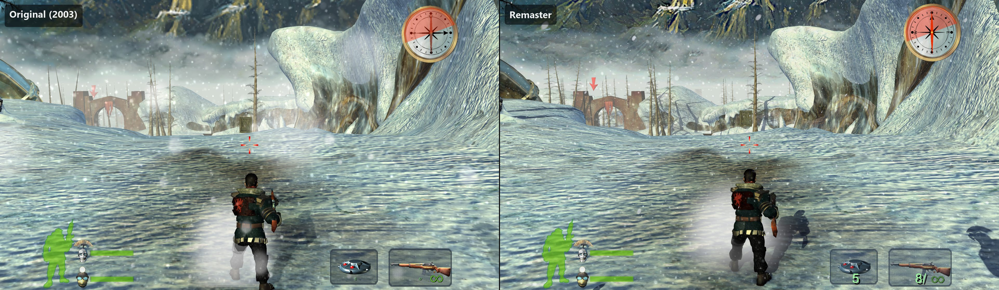

The first view of lev_1_m1, 60 frames after the briefing. The canyon floor is ice (n_ice_test): an environment
material that adds 0.3 of a cube map of the level to its texture. The remaster bakes that cube from the level's env
map marker, as the original renders it once at load, and reflects it per pixel: the blue glint of the original's
ice (`graphics/env_map.rs`). The GPU snowfall (`graphics/snow.rs`: 200,000 flakes falling through gusting wind and
settling on surfaces) replaces the original's snow cylinders at about their visible amount. Also: Roman's sun shadow
(4 cascades of 8192 px, PCSS soft edges), height fog in place of the linear fog, ambient occlusion, the retextured
landscape. Contrast / saturation: original 47.7 / 0.157, remaster 47.3 / 0.154 (before this pass: 31.1 / 0.088).

### Village

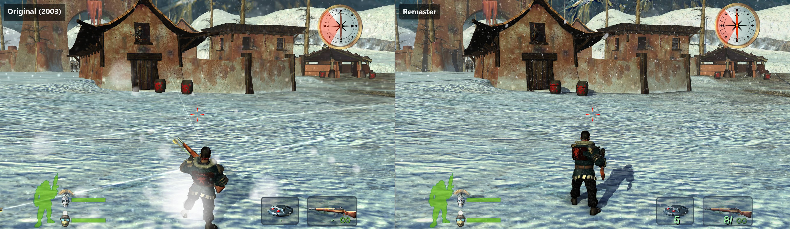

The village houses. Cascaded shadows (Roman's on the snow), ambient occlusion under the eaves and where the walls
meet the ground, retextured walls, roofs and barrels, TAA with sharpening. The roof undersides are dark brown planks in both
(the dark wood, ambient 0.1, faces away from both of the level's lights; the remaster crushed it to black until it
converted the game's values with the sRGB curve instead of a 2.2 power). The soft white blobs in this capture are the
original's camera-locked snow particles, which the remaster's GPU snowfall replaces since 2026-10-24 (player feedback
G6; the image is from before). Contrast / saturation: 55.2 / 0.219 against 52.8 / 0.199
(before: 38.6 / 0.116).

### Village street

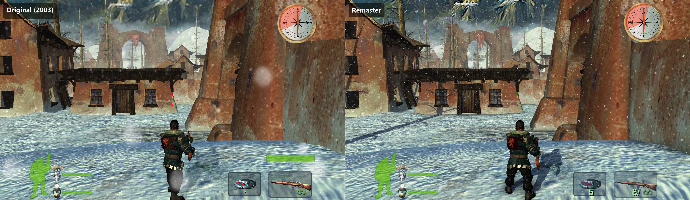

The street towards the ruined arch: the houses and Roman cast shadows across the street; the distant arch sits in
height fog instead of linear fog.

### Courtyard guards

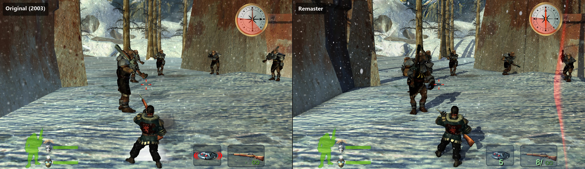

The courtyard's guards. Characters are Phong-tessellated once at load (level 6, crack-free across UV seams,
`graphics/geometry/tessellation.rs`), always drawn at their finest LOD, and lit with ambient occlusion and soft
shadows. Poses and positions differ: the guards run their own AI rolls.

### Retextures, close up

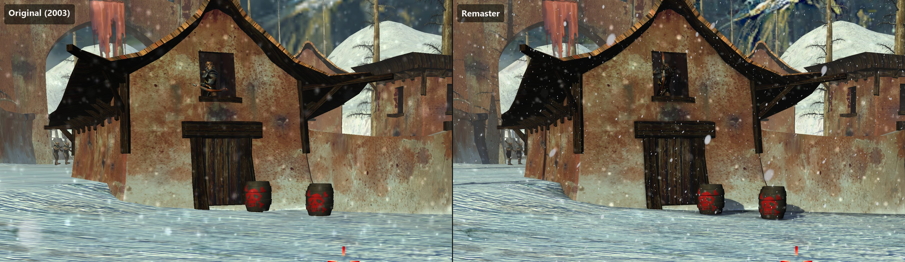

A crop of a 1600x1200 capture. The remaster's textures are AI retextures of the originals (a SeedVR2 canvas
re-rendered by Qwen Image, docs/retexture.md), then colour-locked to the original by `tools/remaster_textures.py`:
shrunk back to the original's size each one is the original texture; only detail finer than one original texel is
new. Normal maps and data textures (blend masks, lightmaps) stay original. The snow over the black roof underside is
now about as sparse as the original's. Not a rendering difference: the archer in the upper window (AI timing).

### Roman, close up

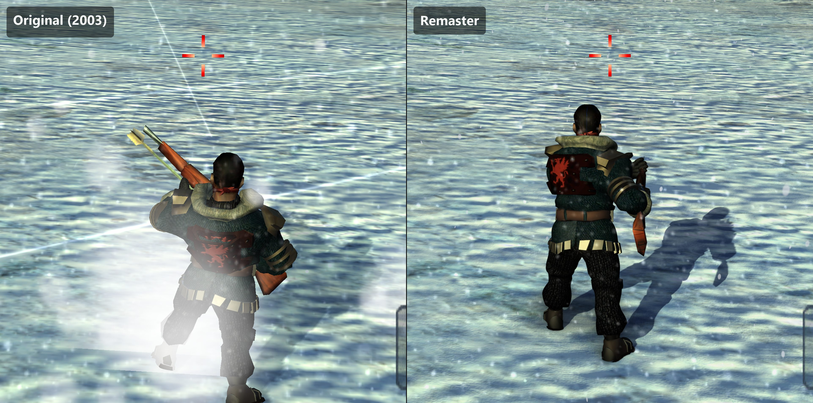

Roman's tessellated mesh and his soft sun shadow on the snow. His pose differs at this frame (the original has him
raising the rifle).

### Widescreen

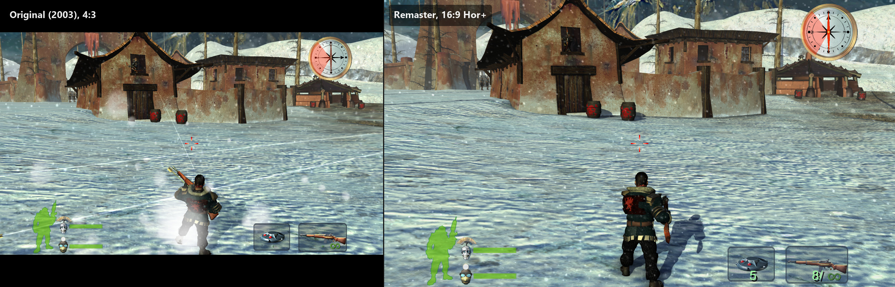

The original renders a 4:3 picture with a 1.72:1 letterboxed 3D view inside it. The remaster fills a 16:9 screen
with Hor+ (the original's vertical field of view, wider horizontally) and no bars. Each side here is its own follow
camera at the same play frame (not the dumped camera), 1280x960 against 1920x1080.

### Farmland at dusk, lev_2_m3

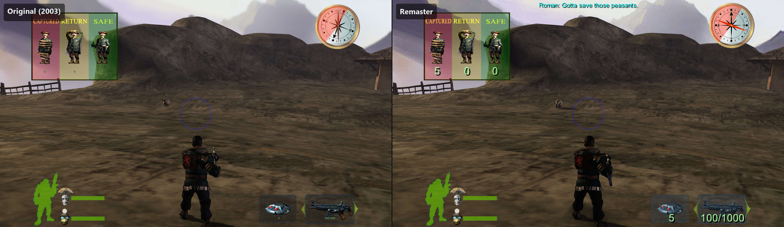

lev_2_m3's start, 5 s after the briefing: a warm, hazy palette, nothing like the snow levels. Retextured ground and
rock, the hill's soft shadow, ambient occlusion along the fence and the slope's folds. Contrast / saturation 53.6 /
0.278 against 57.7 / 0.270.

### The town through the gate, lev_3_m3

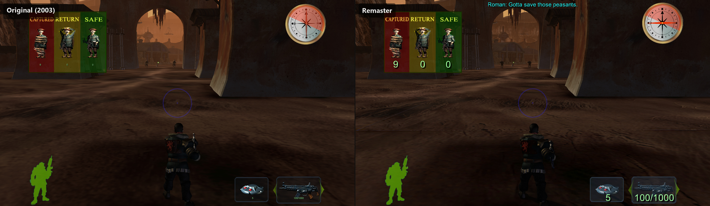

lev_3_m3's start: the town seen through the gate, in the level's orange haze (fog 176, 104, 58). Until this pass the
remaster drew this level, and eight others, without any fog: their global settings give no fog_near of their own, and
the original then takes its property set's value (gamematerial.rs `level_fog`). Saturation 0.547 against 0.563.

### Grass hills in late light, lev_4_m1

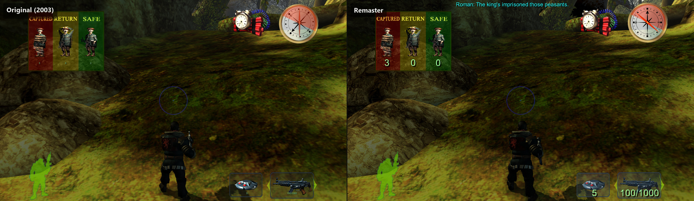

lev_4_m1's start: mossy hills under trees, the strongest colour of the set. Soft canopy shadows across the grass
(the original has none from the trees), ambient occlusion in the rock's folds, retextured grass and stone. Saturation
0.763 against 0.767.

### Water mill, lev_4_m3

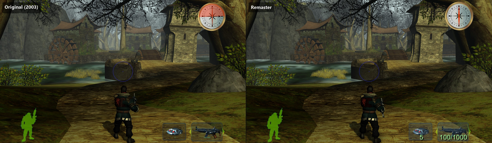

lev_4_m3, the water-mill village, 5 s after the briefing: height fog thickens towards the far mill house, ambient
occlusion grounds the rock and the path's edges, the leaves and walls are retextured.

## Hero image


`docs/images/preview.jpg`: the village pair, the same view side by side (original left, remaster right).

## Videos

`tools/compare_videos.py` records Roman walking forwards for 10 s from the start of every level where he starts on
foot (19 of 24; the five base defence levels start him in a turret), in the original and in the remaster with the
same input (the briefing dismissed, W held), each with its own follow camera, at the gallery's settings: one
side-by-side clip per level (1920 px a side, both games captured at 1080p or above, 30 fps; AV1 at constant quality on the GPU, so no compression artefacts) and the two raw clips, in work/videos/. Too large for the
repository: they are hosted with the texture pack on Cloudflare R2. Original on the left, remaster on the right:

[lev_1_m1](https://pub-7801d845a6624a4881145d2e393c182c.r2.dev/videos/v2/lev_1_m1.mp4) · [lev_1_m1_b](https://pub-7801d845a6624a4881145d2e393c182c.r2.dev/videos/v2/lev_1_m1_b.mp4) · [lev_1_m3](https://pub-7801d845a6624a4881145d2e393c182c.r2.dev/videos/v2/lev_1_m3.mp4) · [lev_2_m1](https://pub-7801d845a6624a4881145d2e393c182c.r2.dev/videos/v2/lev_2_m1.mp4) · [lev_2_m2](https://pub-7801d845a6624a4881145d2e393c182c.r2.dev/videos/v2/lev_2_m2.mp4) · [lev_2_m3](https://pub-7801d845a6624a4881145d2e393c182c.r2.dev/videos/v2/lev_2_m3.mp4) · [lev_3_m1](https://pub-7801d845a6624a4881145d2e393c182c.r2.dev/videos/v2/lev_3_m1.mp4) · [lev_3_m2](https://pub-7801d845a6624a4881145d2e393c182c.r2.dev/videos/v2/lev_3_m2.mp4) · [lev_3_m3](https://pub-7801d845a6624a4881145d2e393c182c.r2.dev/videos/v2/lev_3_m3.mp4) · [lev_4_m1](https://pub-7801d845a6624a4881145d2e393c182c.r2.dev/videos/v2/lev_4_m1.mp4) · [lev_4_m2](https://pub-7801d845a6624a4881145d2e393c182c.r2.dev/videos/v2/lev_4_m2.mp4) · [lev_4_m3](https://pub-7801d845a6624a4881145d2e393c182c.r2.dev/videos/v2/lev_4_m3.mp4) · [lev_5_m1](https://pub-7801d845a6624a4881145d2e393c182c.r2.dev/videos/v2/lev_5_m1.mp4) · [lev_5_m2](https://pub-7801d845a6624a4881145d2e393c182c.r2.dev/videos/v2/lev_5_m2.mp4) · [lev_5_m3](https://pub-7801d845a6624a4881145d2e393c182c.r2.dev/videos/v2/lev_5_m3.mp4) · [lev_5_m4](https://pub-7801d845a6624a4881145d2e393c182c.r2.dev/videos/v2/lev_5_m4.mp4) · [lev_bonus_m1](https://pub-7801d845a6624a4881145d2e393c182c.r2.dev/videos/v2/lev_bonus_m1.mp4) · [lev_bonus_m2](https://pub-7801d845a6624a4881145d2e393c182c.r2.dev/videos/v2/lev_bonus_m2.mp4) · [lev_bonus_m3](https://pub-7801d845a6624a4881145d2e393c182c.r2.dev/videos/v2/lev_bonus_m3.mp4)

## Settings used

"After" is the Remaster preset with every remaster feature on at its highest setting, ray tracing off (the engine
has no ray-tracing option) and motion blur off for stills. The exact changes, as passed to the engine
(`tools/compare_gallery.json`, `remaster.graphics`):

```
and_remaster.exe --background --size <capture size> --play <shot>/remaster.json --camera <shot>/original.camera.json
  --preset remaster --graphics remaster_textures=true,anti_aliasing=taa,alpha_coverage=true,ambient_occlusion=true,
  ao_quality=3,ao_contact=0.6,shadow_map_size=8192,shadow_cascades=4,shadow_distance=1.0,soft_shadows=true,
  fog_modern=true,fog_density=0.6,fog_sun=0.3,tessellation=true,tessellation_level=6,terrain_detail=8,lod_max=true,
  lod_scale=8,aa_mip_bias=-1,tonemap_aces=true,dither=true,snow=true,snow_amount=200000,shutter_speed=0
```

(The capture size is the JSON's: both games at 1080p or above. No `--camera` for the widescreen pair.)

| Feature | Setting |
| --- | --- |
| AI retextures | `remaster_textures` on |
| Anti-aliasing | TAA + contrast-adaptive sharpening 0.35 (preset). Smooth foliage (alpha-to-coverage) needs MSAA, and MSAA turns ambient occlusion off in this engine (Bevy's SSAO), so TAA was used; `alpha_coverage` is set but has no effect under TAA |
| Ambient occlusion | XeGTAO, quality 3 (ultra), radius 24, contact shadows 0.6 |
| Shadows | 4 cascades of 8192 px over the whole drawn distance, PCSS soft shadows (softness 6), shadow strength 0.55 (preset) |
| Fog | exponential height fog, density 0.6, sun glow 0.3 (the preset's since 2026-10-23) |
| Reflections | the environment cube maps, baked at 512 px a face (preset; `tools/bake_env_maps.py`) |
| Geometry | tessellation level 6 (the maximum), terrain detail 8x (the density at which the original's detail maps tile, 2026-10-25), finest LOD everywhere, LOD distances x8 |
| Texture sharpness | mip bias -1 under TAA, 16x anisotropic filtering on world, decal and effect textures (preset) |
| Post | filmic tone curve (`tonemap_aces`: since 2026-10-23 a highlight roll-off that keeps the game's range; the old ACES fit washed the image out), dither, bloom 0.08 (preset); motion blur off (`shutter_speed=0`) |
| Snow | GPU snowfall, 200,000 flakes (the preset's since 2026-10-23, the original's visible amount) |
| Ray tracing | none (the engine has no ray-tracing path) |

## Regenerating

```bash
# build the engine into your own target dir (never engine/target, the player's copy)
cd engine && CARGO_TARGET_DIR=target-wt-shots cargo build --release && cd ..
python tools/bake_env_maps.py                          # the levels' environment cube maps (once per export)
python tools/compare_gallery.py --list                 # the shot list
python tools/compare_gallery.py --stats                # every shot: original, remaster, compose (~45 s a shot)
python tools/compare_gallery.py --only l1_village      # one shot
python tools/compare_gallery.py --skip-original        # re-render the remaster only (after an engine change)
python tools/compare_gallery.py --compose-only         # re-compose from the captures in work/gallery/
python tools/compare_gallery.py --only l1_start --variant nofog=fog_modern=false   # an A/B render with --stats
python tools/compare_videos.py                         # the walk videos into work/videos/ (~3 min a level)
```

Shots are defined in `tools/compare_gallery.json`: level, scripted keys (the hook's `frame:KEY*held` form, counted
from the briefing as `tools/oracle_diff.py` does), the play frame, an optional warp for Roman, a crop, a capture
size, and the remaster's settings. The original runs one instance at a time in its own game instance
(`work/instances/gallery`), off-screen and muted, and waits while the player's own game is running. Raw captures
(PNG, camera dumps, logs) stay in `work/gallery/<shot>/` and are never committed; the composed JPEGs are kept under
1000 KB (`budget_kb`; the repository takes files up to 1 MB). The original very occasionally crashes on exit before its last frame is dumped (lev_3_m3, once): run the shot
again.

Not in the set: an explosion pair (a blast needs a scripted moment that frames the fireball in both games).

## Known differences

Checked by eye against the original in every clip and still of the 2026-10-25 set (status in docs/player-feedback.md).
Fixed for this set: texture density (the materials' second UV set, terrain detail at the original's tiling), the snow
amount, the rain levels' domes, the sky holes, reeds and water, the HUD's opacity, subtitle size, the jetpack's
chrome and wing blades (the depth prepass now culls back faces like the colour pass), the pale shells near the
camera (the follow camera no longer fades characters, as in the original) and the first frame's fog-coloured
silhouettes. The companions now route on the original's 10-unit grid, so Q crosses the lev_5_m3 bridge on the
original's line, and Roman walks off ledges and falls instead of snapping down them (lev_4_m3's mill shelf), and the snow stop-puff no longer fires when he runs into a
wall (lev_1_m1_b).

Style choices (intended):
- **Characters** are lit a little darker than in the original in the non-snow levels (per-pixel sun and soft shadows).
- **The HUD's numbers** are drawn larger and sharper than the original's tiny bitmap digits.
- **Shadows** are cast by the sun from every object; the original has blob shadows under characters only.

Remaining differences (not bugs in the remaster's rendering):
- **Paths diverge** after a few seconds in some clips (AI timing, physics): in lev_bonus_m1 the original's Roman dies
  in the turret fire while the remaster's survives; in lev_2_m2 the original's Roman veers downhill on a steep side slope and is stopped by two kegs; the
  remaster's slides past them, so its camera ends up beside the pipe (the steep-slope drive is not decoded yet,
  docs/open-questions.md). At the end of
  lev_5_m3 the original's Q comes up on Roman's left; the remaster's stops behind Roman, out of view (the leader
  pick on the move is open). At the start of lev_1_m3, lev_5_m2 and lev_5_m3 the original shows Q's gun at the right
  edge.
- **The red band at the screen edge** in the l1_courtyard still is the HUD's hit-direction marker (b_hit, shown
  0.1 s after Roman is hit, 0x004670f0; the original draws it too, lev_1_m1_b f299): the remaster's grunts happen to
  hit Roman at the shot frame.
- **lev_1_m1 stills**: the original's Roman is under the window archer's fire with his rifle raised; the remaster's is
  not attacked yet at that frame (combat timing).
- **lev_4_m3's mill windows** show thin white slits in both games (the original's art).
- **lev_1_m1 pub windows**: not lit as in the original (not examined).